

  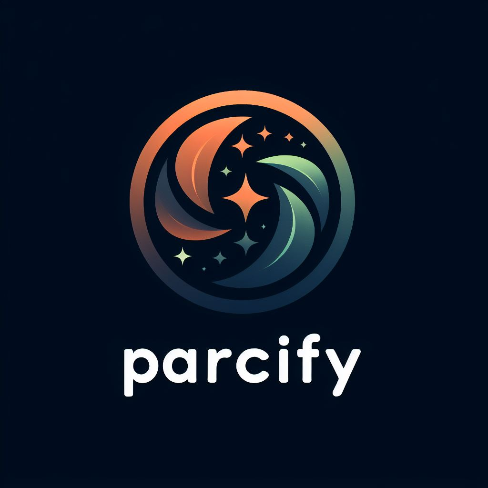

<h1 align="center">Parcify</h1>

Un lienzo colaborativo en tiempo real para diseñar, diagramar y presentar en equipo, desde el navegador.

---

Parcify es un espacio de trabajo visual donde varias personas crean sobre el mismo lienzo a la vez. Abres un proyecto, invitas a tu equipo y todos veis los cambios al instante: los cursores de los demás, lo que seleccionan y lo que escriben. Sirve para bocetar ideas, montar diagramas y esquemas, diseñar interfaces, preparar una presentación o pensar en voz alta sobre un tablero infinito. Y cuando necesitas una mano, un asistente de IA crea y edita por ti, siempre con una vista previa antes de tocar nada.

  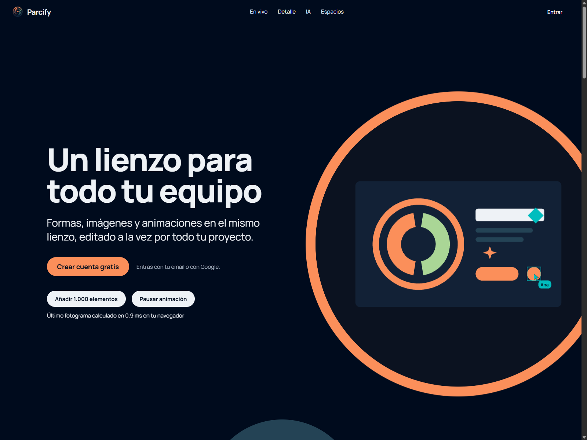

## Contenido

- [Para quién es](#para-quién-es)
- [Qué puedes hacer](#qué-puedes-hacer)
  - [Lienzo y herramientas](#lienzo-y-herramientas)
  - [Edición y estilos](#edición-y-estilos)
  - [Páginas y marcos](#páginas-y-marcos)
  - [Colaboración en tiempo real](#colaboración-en-tiempo-real)
  - [Chat del proyecto](#chat-del-proyecto)
  - [Asistente de IA](#asistente-de-ia)
  - [Animación](#animación)
  - [Versiones e historial](#versiones-e-historial)
  - [Exportar y presentar](#exportar-y-presentar)
  - [Espacios de trabajo y proyectos](#espacios-de-trabajo-y-proyectos)
  - [Compartir e invitar](#compartir-e-invitar)
  - [Plantillas](#plantillas)
  - [Miembros y permisos](#miembros-y-permisos)
  - [Actividad del equipo](#actividad-del-equipo)
  - [Cuentas y acceso](#cuentas-y-acceso)
- [Cómo está hecho](#cómo-está-hecho)
- [Cómo probarlo](#cómo-probarlo)
- [Documentación](#documentación)
- [Autor](#autor)
- [Licencia](#licencia)

## Para quién es

- Equipos de diseño y producto que bocetan y revisan juntos.
- Equipos de marketing que planifican campañas, calendarios y mensajes.
- Quienes hacen diagramas, mapas de experiencia o esquemas de flujos.
- Profesores y formadores que preparan material visual en grupo.
- Cualquiera que quiera un tablero infinito compartido para pensar en equipo.

## Qué puedes hacer

<table>
<tr>
<td width="50%" valign="top">

### Lienzo y herramientas

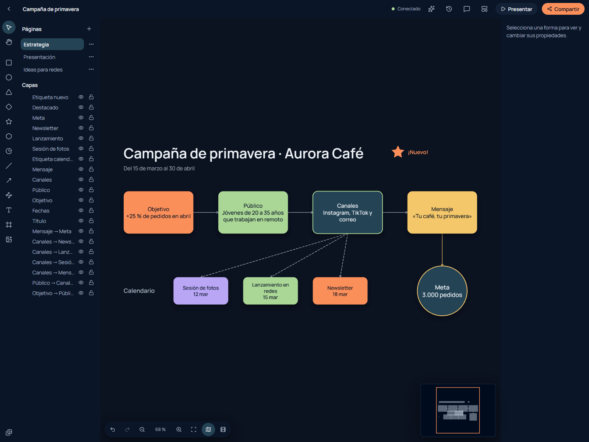

Un lienzo infinito con todo lo necesario para construir:

- Formas (rectángulo, elipse, triángulo, rombo, estrella, polígono, arco, línea y flecha), texto, imágenes y conectores entre elementos.
- Grupos para mover y tratar varias cosas como una sola.
- Árbol de capas y minimapa para no perderte en proyectos grandes.
- Zoom, deshacer y rehacer, y copiar y pegar entre proyectos.

</td>
<td width="50%" valign="top">

### Edición y estilos

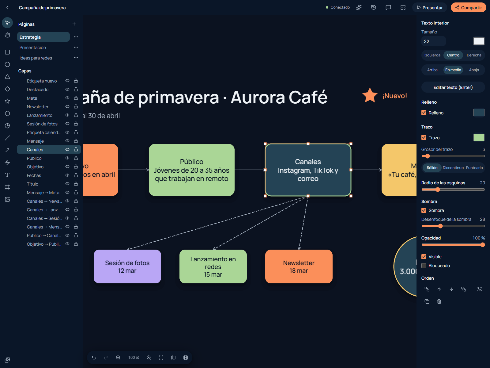

Selecciona cualquier elemento y ajústalo desde su panel de propiedades:

- Relleno, trazo (grosor y estilo), esquinas redondeadas, sombra y opacidad.
- Texto dentro de las formas con fuente, tamaño, peso y alineación.
- Conectores rectos, en codo o curvos, con o sin flecha.
- Ocultar, bloquear, renombrar y reordenar desde la lista de capas.

</td>
</tr>
</table>

<table>
<tr>
<td width="50%" valign="top">

### Páginas y marcos

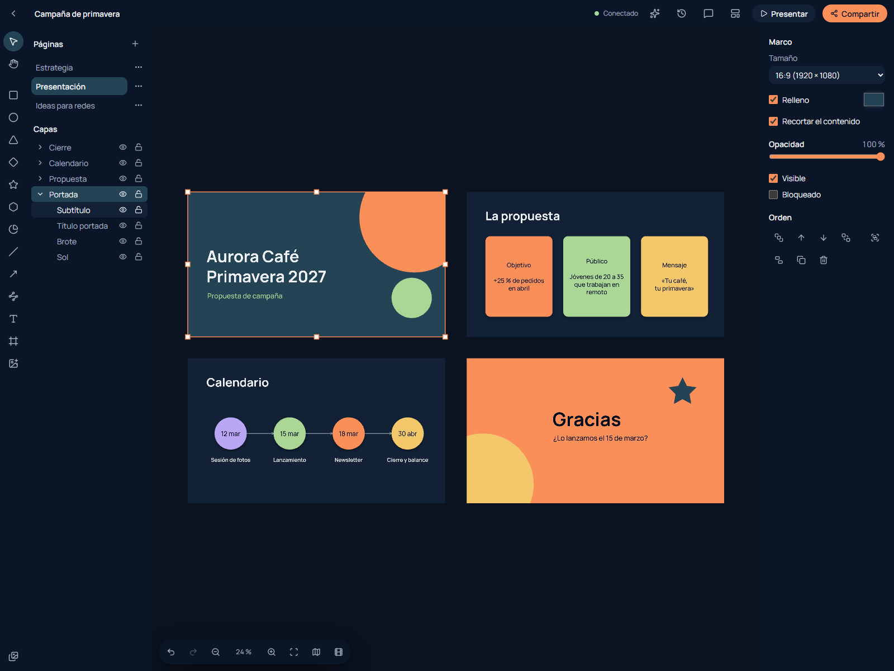

- Varias páginas dentro del mismo proyecto: estrategia en una, presentación en otra.
- Marcos para encuadrar pantallas, diapositivas o secciones, con tamaños predefinidos como 16:9.

</td>
<td width="50%" valign="top">

### Colaboración en tiempo real

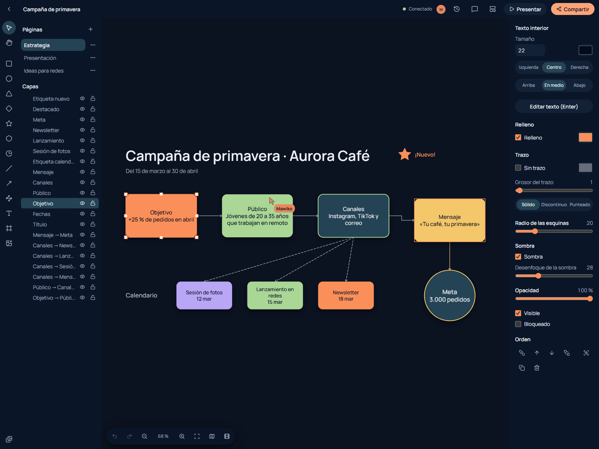

Trabajar a la vez, sin pisarse:

- Varias personas editando el mismo proyecto al mismo tiempo.
- Cursores y selección de cada quien, con su nombre y su color.
- Avatares de quién está dentro y la opción de «Seguir a» otra persona por el lienzo.
- Los cambios se guardan solos y se sincronizan al recuperar la conexión.

</td>
</tr>
</table>

<table>
<tr>
<td width="50%" valign="top">

### Chat del proyecto

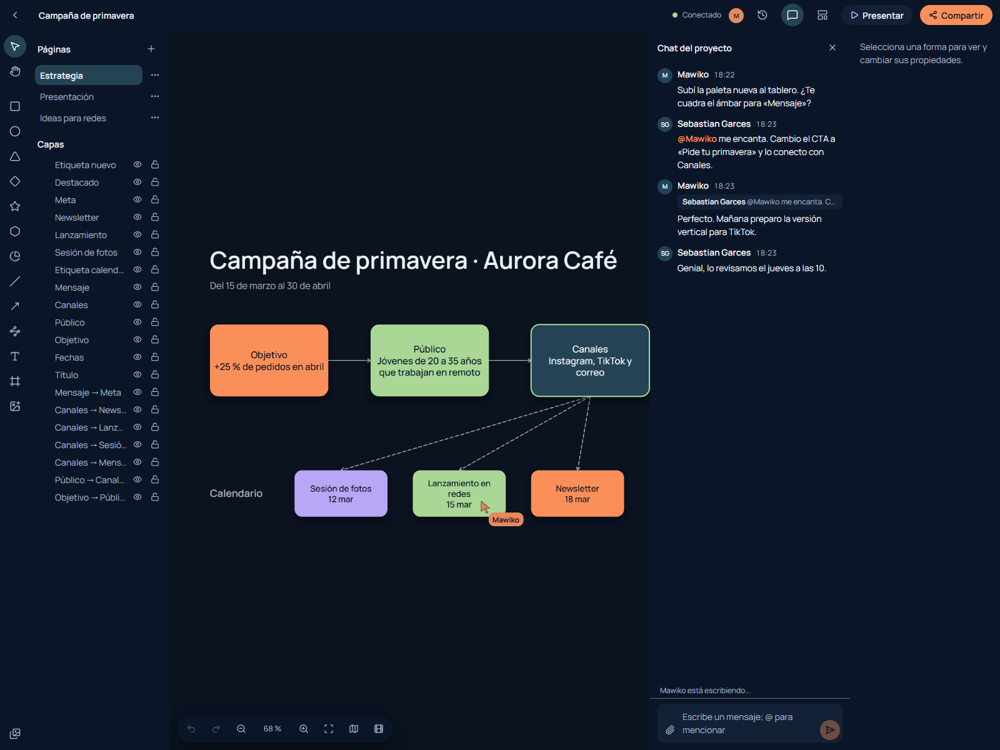

Cada proyecto tiene su conversación, al lado del lienzo:

- Menciones con `@` para avisar a alguien.
- Responder a un mensaje concreto, adjuntar archivos y editar o borrar lo enviado.
- Aviso de «está escribiendo…» y contador de mensajes sin leer.

</td>
<td width="50%" valign="top">

### Asistente de IA

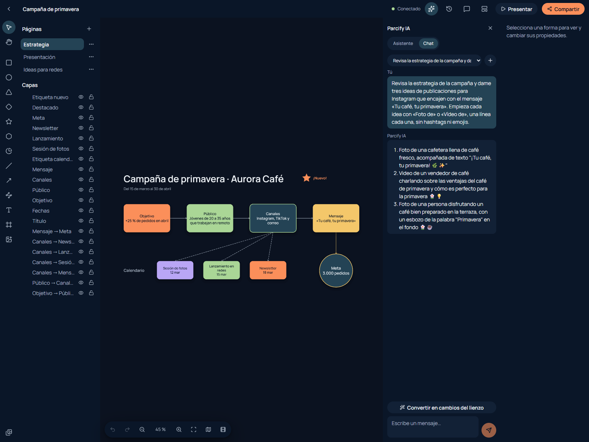

Agentes que entienden tu lienzo y trabajan contigo (opcional, requiere configurar un proveedor de IA):

- Asistente que crea y edita elementos a partir de lo que le pides por texto, con vista previa y los botones Aplicar o Descartar.
- Chat de IA dentro del proyecto que tiene en cuenta lo que ves en el lienzo, para resolver dudas o pedir ideas.
- Animaciones propuestas por la IA sobre los elementos que elijas.
- Generación de imágenes a partir de una descripción.

> Sobre la captura: se hizo en local con Ollama y el modelo `qwen2.5:1.5b` ejecutándose en CPU, por limitaciones de hardware. El servidor corta cada petición de texto a los 60 s (`AI_TEXT_TIMEOUT_MS`, fijo en el código). La calidad, la velocidad y el formato de las respuestas dependen del modelo y del proveedor que configures: OpenAI, Anthropic, Google o cualquier API compatible con OpenAI.

</td>
</tr>
</table>

<table>
<tr>
<td width="50%" valign="top">

### Animación

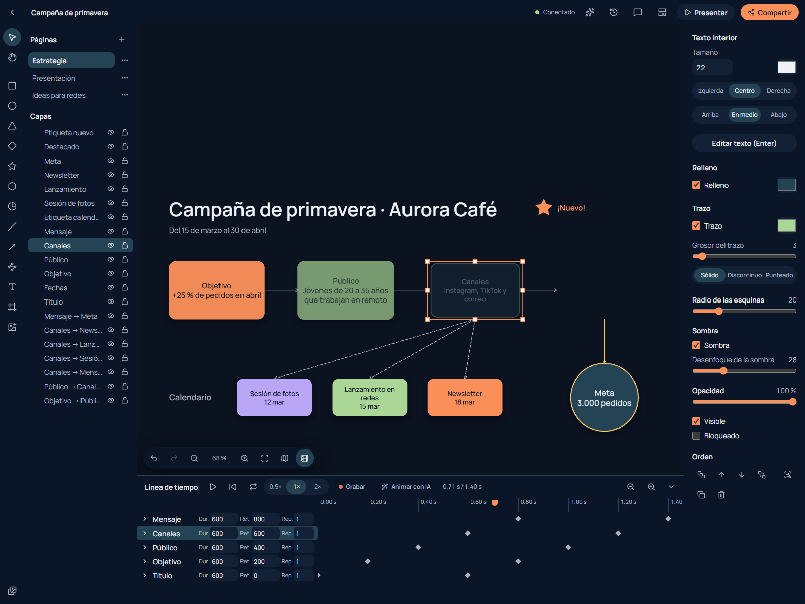

Da vida a tus diseños:

- Línea de tiempo por fotogramas clave para animar posición, escala, opacidad y más.
- Curvas de suavizado, retardos, duración y bucle.
- Reproducción directa en el editor para ver el resultado al instante.

</td>
<td width="50%" valign="top">

### Versiones e historial

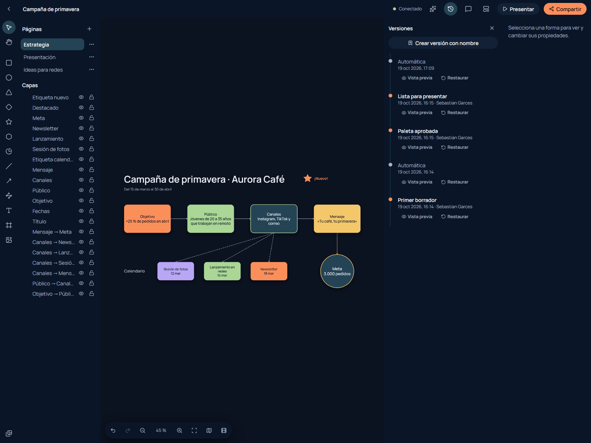

- Versiones automáticas y versiones con nombre de cada proyecto.
- Vista previa de una versión anterior antes de decidir.
- Restaurar el proyecto a un punto previo cuando haga falta.

</td>
</tr>
</table>

### Exportar y presentar

- Exportar a PNG, JPG, SVG y PDF, a la escala que necesites.
- Importar y exportar el formato propio `.parcify` para mover proyectos entre cuentas.
- Modo presentar: los marcos de la página se convierten en diapositivas a pantalla completa.

<table>
<tr>
<td width="50%" valign="top">

Exportar

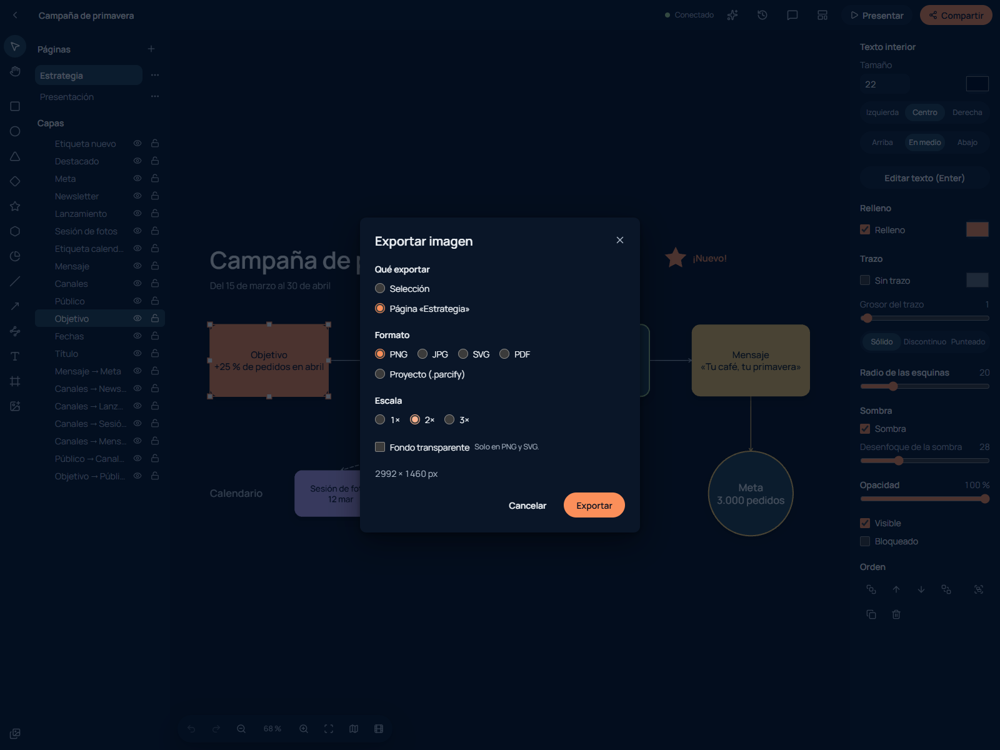

</td>
<td width="50%" valign="top">

Presentar

</td>
</tr>
</table>

### Espacios de trabajo y proyectos

Todo en su sitio, también cuando hay mucho:

- Espacios de trabajo para cada equipo, cliente o tema.
- Proyectos con vista previa, quién lo editó por última vez y cuándo.
- Búsqueda, filtros, orden y favoritos.
- Papelera para recuperar lo que borras sin querer.

<table>
<tr>
<td width="50%" valign="top">

Crear un espacio

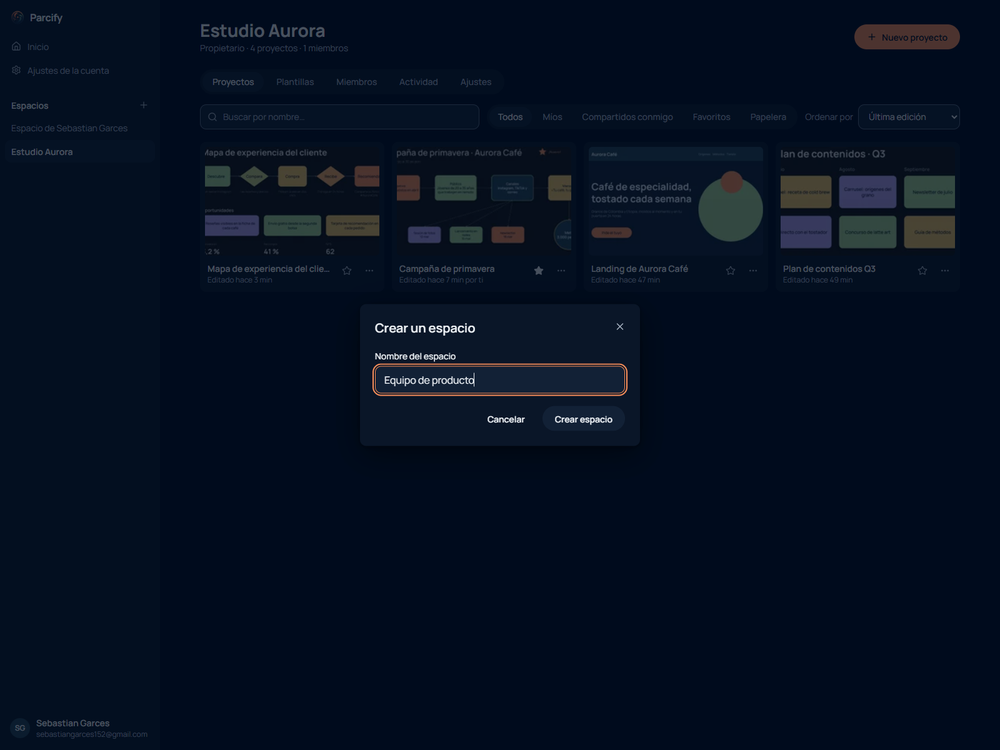

</td>
<td width="50%" valign="top">

Proyectos del espacio

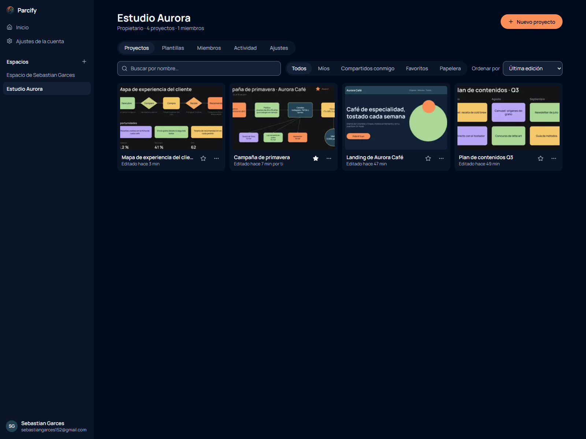

</td>
</tr>
</table>

### Compartir e invitar

- Invita por email a un proyecto con el rol que quieras.
- Enlaces para compartir con rol, caducidad, número de usos y la opción de revocarlos.
- Invitaciones a un espacio de trabajo que la otra persona acepta o rechaza desde su correo.

<table>
<tr>
<td width="50%" valign="top">

Compartir un proyecto

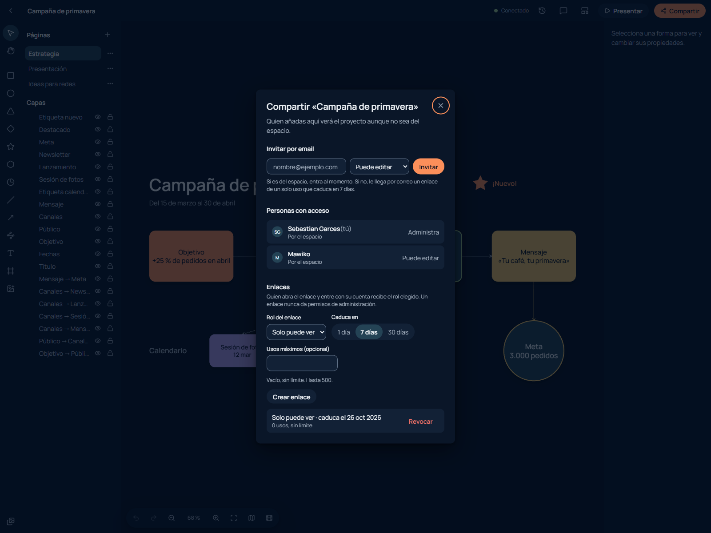

</td>
<td width="50%" valign="top">

Aceptar una invitación

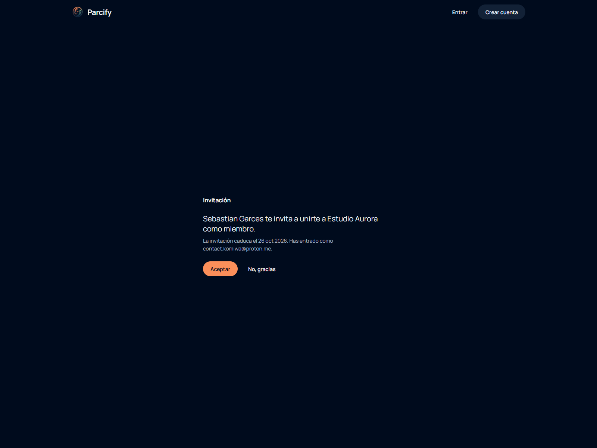

</td>
</tr>
</table>

<table>
<tr>
<td width="50%" valign="top">

### Plantillas

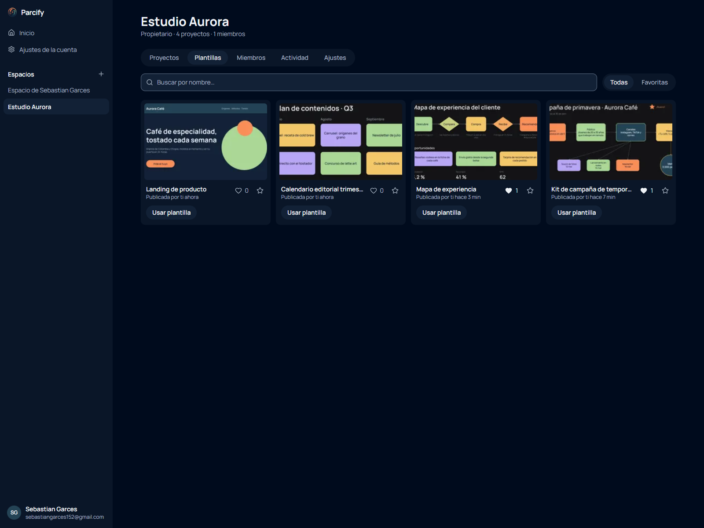

- Publica cualquier proyecto como plantilla del espacio.
- Galería de plantillas con «me gusta» para encontrar las más útiles.
- Crea un proyecto nuevo a partir de una plantilla en un clic.

</td>
<td width="50%" valign="top">

### Miembros y permisos

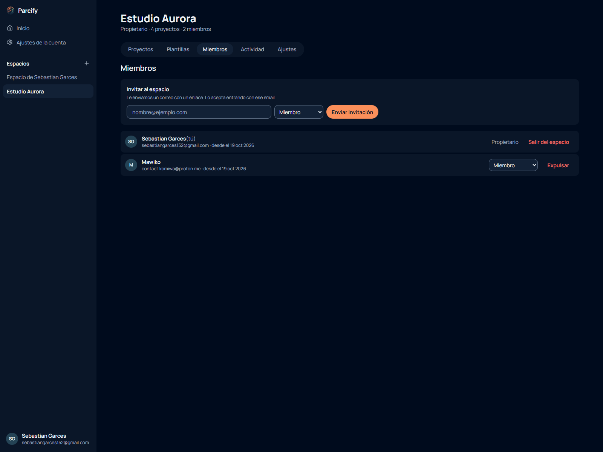

- Roles de propietario, administrador y miembro en cada espacio.
- Permisos por proyecto: quién puede ver, editar o administrar.
- Cambiar el rol de alguien, expulsarlo o salir del espacio.

</td>
</tr>
</table>

<table>
<tr>
<td width="50%" valign="top">

### Actividad del equipo

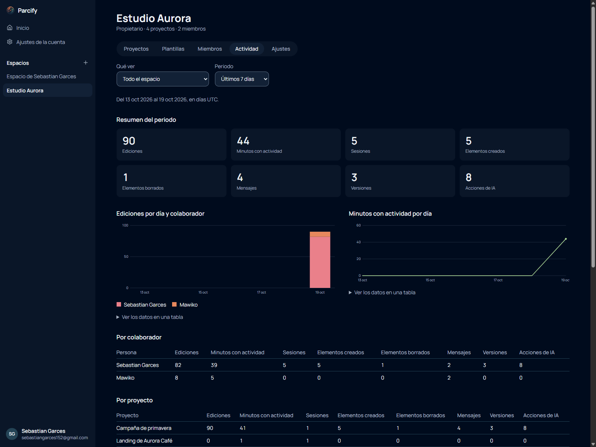

- Métricas por espacio o por proyecto de los últimos 7, 30 o 90 días.
- Ediciones por día y por colaborador, minutos con actividad, sesiones y mensajes.
- Historial de eventos para ver cómo avanza el trabajo.

</td>
<td width="50%" valign="top">

### Cuentas y acceso

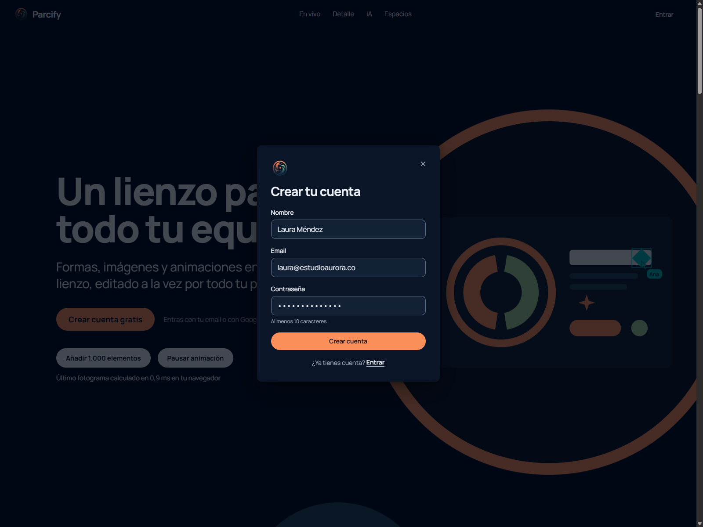

- Registro con email y contraseña, con verificación por código que llega al correo.
- Recuperar la contraseña y entrar con Google.
- Ajustes de perfil, sesiones abiertas, registro de seguridad y preferencias.

</td>
</tr>
</table>

## Cómo está hecho

Parcify se usa desde el navegador. Detrás hay un servidor para las cuentas y los proyectos, otro que mantiene la edición en vivo entre todas las personas conectadas, una base de datos, un servicio de mensajería interna, un almacén para las imágenes (o una carpeta en disco), el correo para verificaciones e invitaciones y, si se quiere, un proveedor de IA externo.

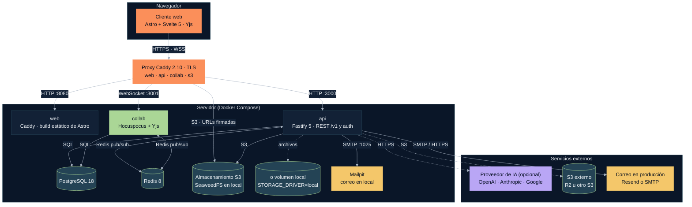

  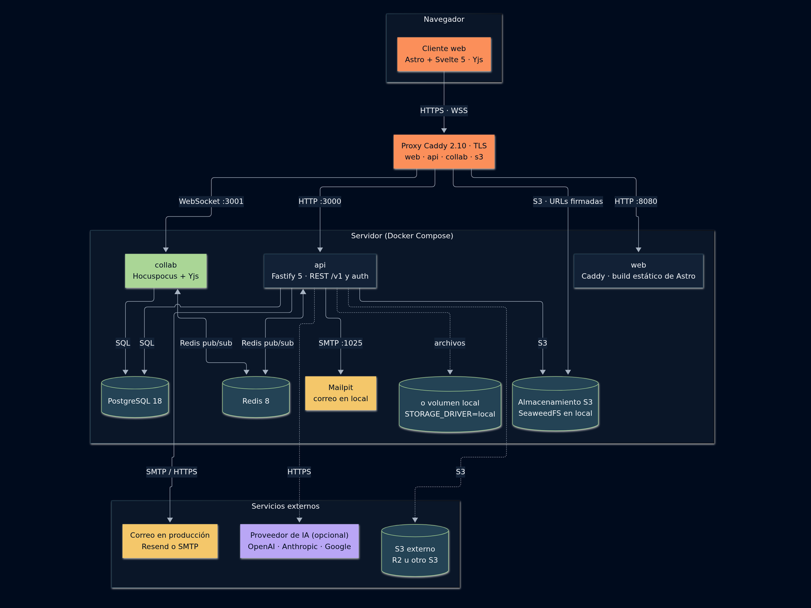

El detalle técnico de cada parte está en [client/README.md](client/README.md) y [server/README.md](server/README.md).

## Cómo probarlo

Puedes ponerlo en marcha en tu equipo en unos minutos o desplegarlo en un servidor para todo el equipo. Los pasos están en [DEPLOY.md](DEPLOY.md):

- En Railway, con las imágenes guardadas en un volumen, para usarlo de verdad.
- En tu equipo, para desarrollar o probar, o con HTTPS como si fuera producción.
- En un VPS propio con Docker.

## Documentación

- [DEPLOY.md](DEPLOY.md): cómo desplegar Parcify en Railway con un volumen, en tu equipo o en un VPS.
- [client/README.md](client/README.md): detalles técnicos del cliente web.
- [server/README.md](server/README.md): detalles técnicos del servidor (API y colaboración).

## Autor

Hecho por Sebxstt ([GarcesSebastian](https://github.com/GarcesSebastian)).

## Licencia

[MIT](LICENSE).
